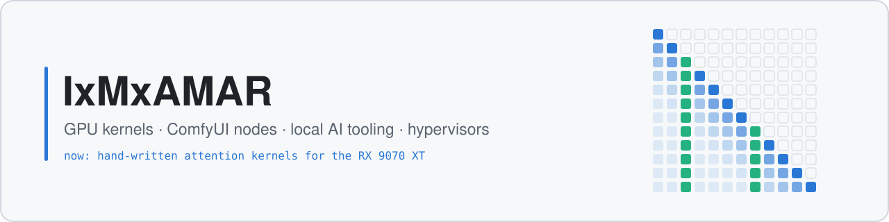

<picture>
  <source media="(prefers-color-scheme: dark)" srcset="assets/header-dark.svg">
  
</picture>

<p align="center">
  <a href="https://github.com/IxMxAMAR">
    
  </a>
</p>

# Hi, I'm IxMxAMAR

I like making generative models run faster, and run on hardware people actually own. That means hand-written attention kernels for AMD's RX 9070 XT, ComfyUI node packs, one-click RunPod images, and tools for running LLMs locally. On the side, I write hypervisors.

---

## 🏆 Flagship Engineering Highlights

<table width="100%">
<tr>
<td width="50%" valign="top">

### 🚀 [SageAttention-RDNA4](https://github.com/IxMxAMAR/SageAttention-RDNA4)
> **Quantized Attention Kernels for AMD RDNA4 (`gfx1201` / RX 9070 & 9070 XT)**

- **Hand-written HIP Attention Kernels**: Custom FP16 and BF16 attention implementations designed specifically for RDNA4 compute units and memory hierarchy.
- **Fused Video Model Workloads**: Handles native fused Q/K/V tensors sent by modern video diffusion architectures (Wan 2.2, HunyuanVideo, LTX-Video).
- **Extreme Speedup**: Up to **2.3× faster** than generic gfx12 ports, matching **0.87–0.94×** execution latency over upstream PR #368 across production batch sizes.
- **Drop-in ComfyUI Integration**: Seamless plug-and-play drop-in for local diffusion inference pipelines without recompilation hurdles.

```
Stack: ROCm / HIP • C++ • PyTorch • RDNA4 gfx1201 • Video Diffusion
```
<p align="right"><a href="https://github.com/IxMxAMAR/SageAttention-RDNA4"></a></p>

</td>
<td width="50%" valign="top">

### 🛡️ [Aria](https://github.com/IxMxAMAR/Aria)
> **Type-1 Bare-Metal Hypervisor with In-Place OS Virtualization**

- **UEFI Bootloader Architecture**: Boots directly from UEFI firmware prior to OS initialization, taking full hardware control before Windows boots.
- **In-Place Windows Virtualization**: Dynamically transforms the running Windows kernel into a guest VM without rebooting or disconnecting hardware.
- **Nested VMX Engine**: Full Intel VT-x hardware-assisted virtualization with comprehensive VMCS configuration and nested virtualization support.
- **Advanced EPT & Shadowing**: Extended Page Tables for transparent physical memory virtualization, stealth page hiding, and VMCALL dispatch control.

```
Stack: C • x86_64 ASM • UEFI / EDK2 • Intel VT-x • EPT Paging
```
<p align="right"><a href="https://github.com/IxMxAMAR/Aria"></a></p>

</td>
</tr>
</table>

---

## 🛠️ Technical Stack & Expertise

### 💻 Low-Level Systems & Hypervisors


### ⚡ AI Acceleration & GPU Compute


-990000?style=flat-square&logo=amd&logoColor=white)


### ☁️ Cloud & Infrastructure


### 🔧 Languages & Applied Tooling


-DC382D?style=flat-square)


---

## ⚡ GPU & Performance

| Project | What it is | |
|---|---|---|
| [SageAttention-RDNA4](https://github.com/IxMxAMAR/SageAttention-RDNA4) | SageAttention for the RX 9070 / 9070 XT (`gfx1201`), with hand-written HIP attention kernels for fp16 and bf16. Up to 2.3× faster than generic gfx12 ports, handling fused q/k/v views for video models, and a drop-in for ComfyUI. |  |
| [bitsandbytes](https://github.com/IxMxAMAR/bitsandbytes) | Accessible large language models via k-bit quantization for PyTorch with ROCm / AMD GPU acceleration enhancements. |  |
| [comfyui-mossdype](https://github.com/IxMxAMAR/comfyui-mossdype) | DyPE-M dynamic position extrapolation for MOSS-Image — render past the 4MP training range without retraining. |  |

## 🧩 ComfyUI Node Ecosystem

| Project | What it is | |
|---|---|---|
| [ComfyUI-API-Toolkit](https://github.com/IxMxAMAR/ComfyUI-API-Toolkit) | Kling AI, ElevenLabs, and Google Gemini in one extensible package: 68 production nodes. |  |
| [ComfyUI-Utility-MegaPack](https://github.com/IxMxAMAR/ComfyUI-Utility-MegaPack) | Comprehensive utility pack featuring 156 operations condensed across 7 nodes, with 11 custom visual graph themes. |  |
| [ComfyUI-IxMxAMAR-Masterworks](https://github.com/IxMxAMAR/ComfyUI-IxMxAMAR-Masterworks) | 12 production-ready masterwork workflow templates orchestrating multimodal generation pipelines end-to-end. |  |
| [ComfyUI-NanoBanana2](https://github.com/IxMxAMAR/ComfyUI-NanoBanana2) | Full-parameter Google Gemini API node pack for ComfyUI: text, vision, high-res image generation, audio, music, video, and embeddings. |  |
| [ComfyUI-NanoBanana-FaceSwap](https://github.com/IxMxAMAR/ComfyUI-NanoBanana-FaceSwap) | Zero-shot face and head replacement powered by Gemini multimodal semantic image editing. |  |
| [ComfyUI-ElevenLabs-Pro](https://github.com/IxMxAMAR/ComfyUI-ElevenLabs-Pro) | Full-featured ElevenLabs in ComfyUI: voice cloning, low-latency TTS, speech-to-speech, sound effects, and generative music. |  |
| [ComfyUI-Kling-Direct](https://github.com/IxMxAMAR/ComfyUI-Kling-Direct) | Native Kling AI API integration for ComfyUI: video, image, and audio generation using your own API key. |  |

## ☁️ Cloud & RunPod

| Project | What it is | |
|---|---|---|
| [ComfyUI-Ultimate](https://github.com/IxMxAMAR/ComfyUI-Ultimate) | Batteries-included ComfyUI Docker image for RunPod: 29 curated node packs, SageAttention and FlashAttention, pinned dependencies, CI-gated builds. |  |
| [ComfyUI-Ultimate-ST](https://github.com/IxMxAMAR/ComfyUI-Ultimate-ST) | All-in-one RunPod image combining ComfyUI-Ultimate generation with SillyTavern AI chat. |  |
| [runpod-wan22-serverless](https://github.com/IxMxAMAR/runpod-wan22-serverless) | Serverless Wan 2.2 14B text-to-video and image-to-video worker endpoints for RunPod, with desktop client integration. |  |
| [ComfyUI-Serverless-FaceSwap](https://github.com/IxMxAMAR/ComfyUI-Serverless-FaceSwap) | Scalable ComfyUI face-swap workflows served as an on-demand RunPod serverless API. |  |
| [rigma-runpod](https://github.com/IxMxAMAR/rigma-runpod) | Hardware-tuned RunPod pod template, Dockerfile, and container startup spec for instant Rigma LLM deployments. |  |

## 🖥️ Local AI Tooling

| Project | What it is | |
|---|---|---|
| [rigma](https://github.com/IxMxAMAR/rigma) | Hardware-aware local LLM deployment: `rigma up` probes your GPU and RAM and serves the best-tuned model setup for that exact machine. |  |
| [rigma-registry](https://github.com/IxMxAMAR/rigma-registry) | Community registry of verified, benchmarked model + quant + flag combinations for Rigma hardware-aware deployments. |  |
| [raggity](https://github.com/IxMxAMAR/raggity) | Local-first search and Q&A over notes, docs, and PDFs: hybrid retrieval, cross-encoder reranking, and verified citations powered by Claude Agent SDK (CLI & FastAPI). |  |
| [LoRA-Dataset-Forge](https://github.com/IxMxAMAR/LoRA-Dataset-Forge) | Two photos in, a captioned, aspect-bucketed LoRA training set out, with review step, Gemini face validation, and one-click export. |  |

## 🛠️ Systems & Hypervisors

| Project | What it is | |
|---|---|---|
| [Aria](https://github.com/IxMxAMAR/Aria) | A Type-1 hypervisor in C that boots through UEFI and virtualizes a running Windows in place, with a full nested VMX engine and EPT paging. |  |
| [Visor](https://github.com/IxMxAMAR/Visor) | Personal hypervisor experiment in Rust: UEFI loader, Windows kernel driver, VMCALL dispatch, and EPT page hiding. |  |
| [barevisor](https://github.com/IxMxAMAR/barevisor) | Personal fork of tandasat's barevisor in Rust with experimental modifications and stealth enhancements. |  |
| [SimpleVisor](https://github.com/IxMxAMAR/SimpleVisor) | Modified SimpleVisor, ionescu007's minimal Intel VT-x hypervisor in C with custom telemetry and hooks. |  |

## 🔬 Research & Innovation

| Project | What it is | |
|---|---|---|
| [Research-and-Innovation](https://github.com/IxMxAMAR/Research-and-Innovation) | A living compilation of research papers and ideas organized by domain. First entry: *The x16 Ceiling* (PCIe memory bandwidth and host-to-device streaming saturation). |  |

---

## 🐍 Contribution Activity

<picture>
  <source media="(prefers-color-scheme: dark)" srcset="https://raw.githubusercontent.com/IxMxAMAR/IxMxAMAR/output/github-contribution-grid-snake-dark.svg">
  <source media="(prefers-color-scheme: light)" srcset="https://raw.githubusercontent.com/IxMxAMAR/IxMxAMAR/output/github-contribution-grid-snake.svg">
  
</picture>

---

## 📊 Activity & Statistics

<p align="center">
  <picture>
    <source media="(prefers-color-scheme: dark)" srcset="https://github-readme-stats.vercel.app/api?username=IxMxAMAR&show_icons=true&hide_rank=true&hide_border=true&disable_animations=true&theme=tokyonight&bg_color=0d1117&title_color=3987e5&icon_color=3987e5&text_color=9198a1">
    <source media="(prefers-color-scheme: light)" srcset="https://github-readme-stats.vercel.app/api?username=IxMxAMAR&show_icons=true&hide_rank=true&hide_border=true&disable_animations=true">
    
  </picture>
  <picture>
    <source media="(prefers-color-scheme: dark)" srcset="https://github-readme-streak-stats.herokuapp.com/?user=IxMxAMAR&theme=tokyonight&background=0D1117&border=30363D&stroke=30363D&ring=3987E5&fire=3987E5&currStreakNum=F0F6FC&sideNums=F0F6FC&currStreakLabel=3987E5&sideLabels=9198A1&dates=9198A1&hide_border=true">
    <source media="(prefers-color-scheme: light)" srcset="https://github-readme-streak-stats.herokuapp.com/?user=IxMxAMAR&hide_border=true">
    
  </picture>
  <picture>
    <source media="(prefers-color-scheme: dark)" srcset="https://github-readme-stats.vercel.app/api/top-langs/?username=IxMxAMAR&layout=compact&hide_border=true&disable_animations=true&theme=tokyonight&bg_color=0d1117&title_color=3987e5&text_color=9198a1">
    <source media="(prefers-color-scheme: light)" srcset="https://github-readme-stats.vercel.app/api/top-langs/?username=IxMxAMAR&layout=compact&hide_border=true&disable_animations=true">
    
  </picture>
</p>

---

## 🌐 Connect & Collaborate

<p align="center">
  <a href="https://github.com/IxMxAMAR"></a>
  <a href="mailto:officialamrendrasingh@gmail.com"></a>
  <a href="https://huggingface.co/IxMxAMAR"></a>
  <a href="https://runpod.io"></a>
</p>
